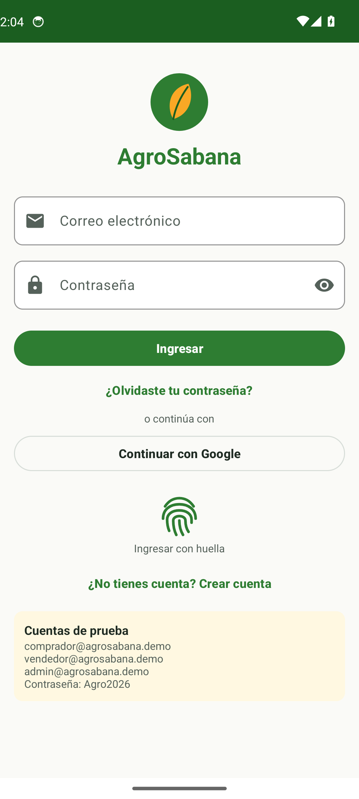
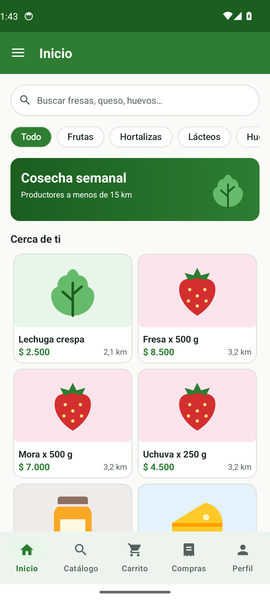
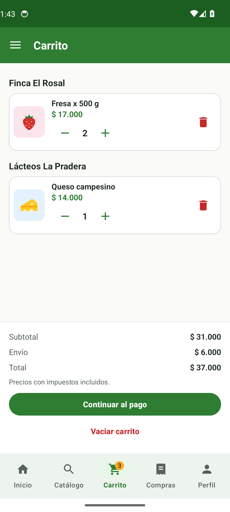
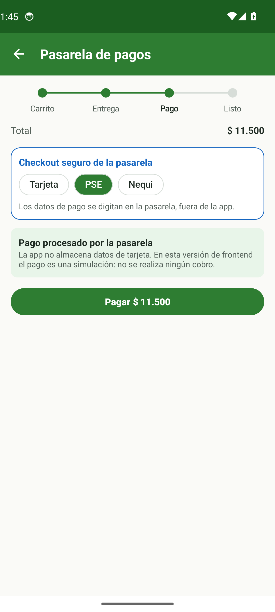
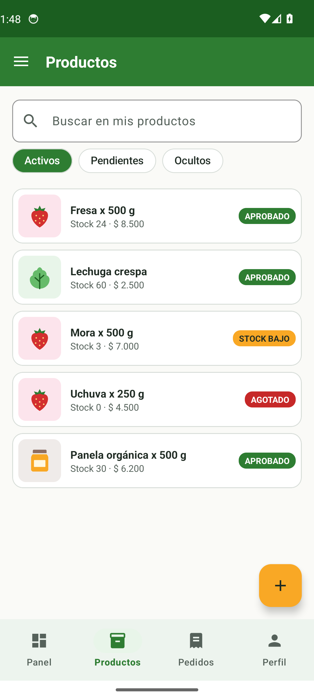
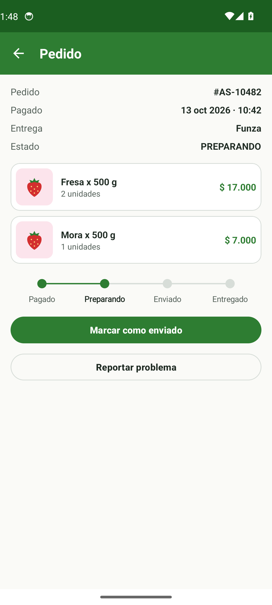
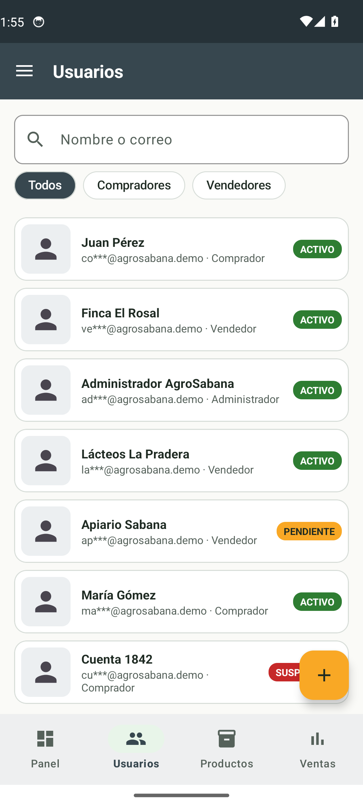
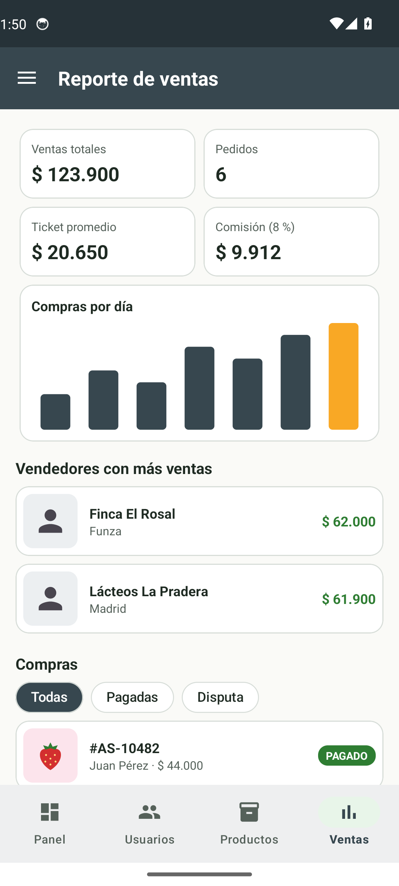

# AgroSabana

Frontend de una tienda virtual nativa para Android que conecta a pequeños productores de la Sabana de Occidente con compradores cercanos. Proyecto de la asignatura Desarrollo de Aplicaciones Móviles, Fundación Universitaria Compensar.

**Alcance de esta entrega:** solo interfaz. Los datos viven en memoria (`data/Store.kt`) para que todos los CRUD se puedan recorrer sin servidor, y vuelven al estado inicial al cerrar la app. Los pagos son simulados: no se hace ningún cobro ni se piden datos de tarjeta.

| | | | |
|---|---|---|---|
|  |  |  |  |
|  |  |  |  |

## Cuentas de prueba

Contraseña de todas: `Agro2026`

| Rol | Correo |
|---|---|
| Comprador | `comprador@agrosabana.demo` |
| Vendedor | `vendedor@agrosabana.demo` |
| Administrador | `admin@agrosabana.demo` |

Son datos ficticios incluidos en el código solo para la demostración.

## Pantallas por rol

| Rol | Pantalla | Clase | Layout |
|---|---|---|---|
| Todos | Splash | `ui/auth/SplashActivity` | `activity_splash` |
| Todos | Inicio de sesión y huella | `ui/auth/LoginActivity` | `activity_login` |
| Todos | Registro con rol | `ui/auth/RegisterActivity` | `activity_register` |
| Todos | Recuperar contraseña | `ui/auth/RecoverPasswordActivity` | `activity_recover` |
| Todos | Drawer y Bottom Navigation | `ui/common/RoleHostActivity` | `activity_role_host`, `menu/` |
| Comprador | Inicio | `BuyerHomeFragment` | `fragment_buyer_home` |
| Comprador | Catálogo | `CatalogFragment` | `fragment_catalog` |
| Comprador | Detalle de producto | `ProductDetailActivity` | `activity_product_detail` |
| Comprador | Carrito | `CartFragment` | `fragment_cart`, `item_cart` |
| Comprador | Entrega y resumen | `CheckoutActivity` | `activity_checkout` |
| Comprador | Pasarela de pagos | `PaymentActivity` | `activity_payment` |
| Comprador | Confirmación | `PaymentResultActivity` | `activity_payment_result` |
| Comprador | Historial de compras | `BuyerOrdersFragment` | `fragment_list` |
| Comprador | Perfil y edición | `ProfileFragment`, `EditProfileActivity` | `fragment_profile`, `activity_edit_profile` |
| Vendedor | Panel | `SellerDashboardFragment` | `fragment_dashboard` |
| Vendedor | Productos (CRUD) | `SellerProductsFragment`, `ProductFormActivity` | `fragment_list`, `activity_product_form` |
| Vendedor | Pedidos recibidos | `SellerOrdersFragment`, `SellerOrderDetailActivity` | `fragment_list`, `activity_seller_order_detail` |
| Vendedor | Perfil de vendedor | `SellerProfileFragment` | `fragment_seller_profile` |
| Administrador | Dashboard | `AdminDashboardFragment` | `fragment_dashboard` |
| Administrador | Usuarios (CRUD) | `AdminUsersFragment`, `UserFormActivity` | `fragment_list`, `activity_user_form` |
| Administrador | Productos | `AdminProductsFragment`, `ProductReviewActivity` | `fragment_list`, `activity_product_review` |
| Administrador | Reporte de ventas | `SalesReportFragment` | `fragment_sales_report` |

## Recursos

- `res/values/colors.xml` y `values-night/colors.xml`: paleta propia (verde `#2E7D32`, ámbar `#F9A825`, gris azulado `#37474F`) con tema claro y oscuro.
- `res/values/themes.xml`: `Theme.AgroSabana` y `Theme.AgroSabana.Admin`, que distingue con color al rol con privilegios.
- `res/values/styles.xml`: estilos propios de botones, campos, tarjetas, chips y tipografía.
- `res/values/strings.xml` y `dimens.xml`: textos en es-CO, plurales y medidas, incluida el área táctil mínima de 48 dp.
- `res/drawable/`: logo, iconos e ilustraciones vectoriales, formas (`shape`), degradado y `layer-list`.

## Compilar

Requiere JDK 17 y Android SDK 36, o abrir la carpeta en Android Studio.

```
gradlew assembleDebug
```

El APK queda en `app/build/outputs/apk/debug/app-debug.apk`. Es compatible desde Android 8.0 (API 26).

## Documentación

- [`docs/Anexo_Actualizacion_Documento_Tecnico.pdf`](docs/Anexo_Actualizacion_Documento_Tecnico.pdf): cambios del documento técnico para que coincida con lo implementado y lista de lo simulado o pendiente para el backend.
