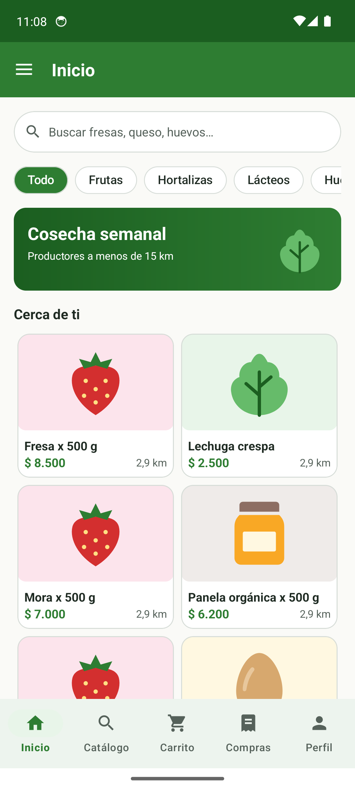
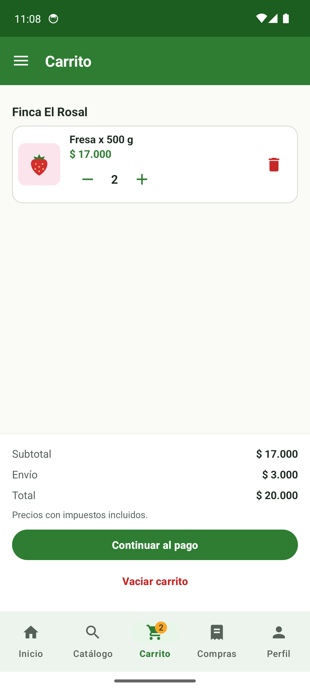
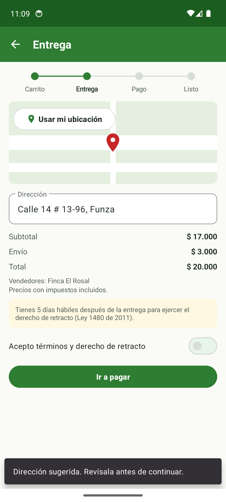
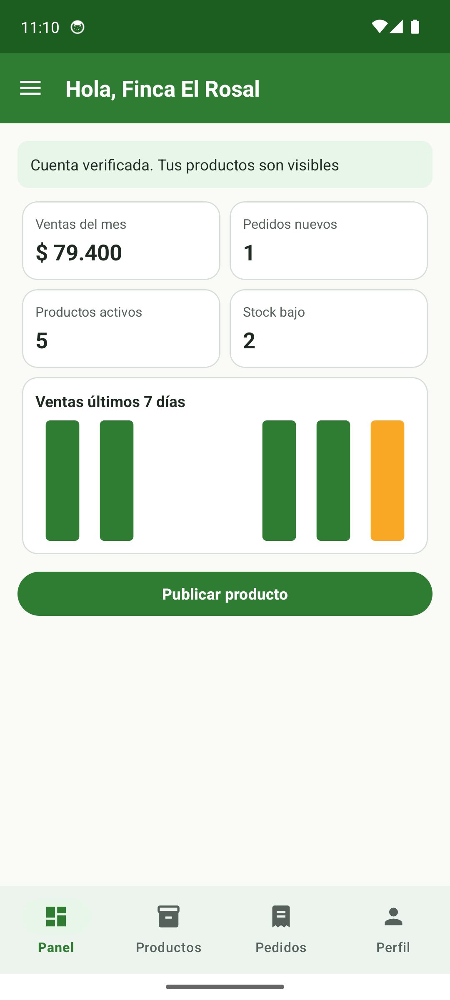
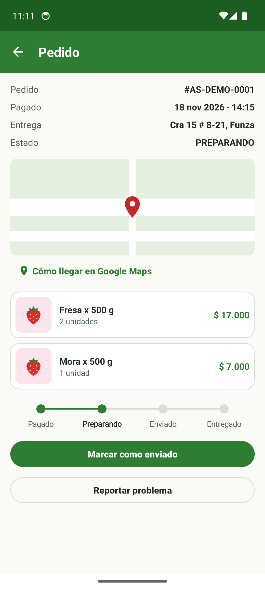
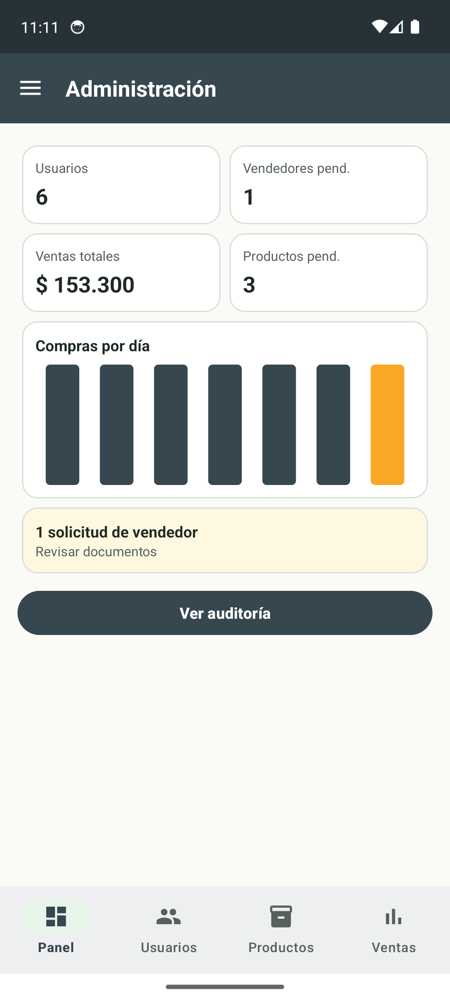

# AgroSabana

Tienda virtual nativa para Android que conecta a pequeños productores de la Sabana de Occidente con compradores cercanos. Proyecto de la asignatura Desarrollo de Aplicaciones Móviles, Fundación Universitaria Compensar.

**Versión 2.0 (beta funcional):** autenticación, base de datos y lógica conectadas a Firebase; huella dactilar con llave del Android Keystore; geolocalización con Google Play Services; pasarela de pagos ePayco.

| | | |
|---|---|---|
|  |  |  |
|  |  |  |

## Funcionalidades

| Componente | Implementación |
|---|---|
| Autenticación (3 roles) | Firebase Authentication: registro, inicio y cierre de sesión, recuperación de contraseña por correo |
| Huella dactilar | `BiometricPrompt` (BIOMETRIC_STRONG) + llave AES del Android Keystore que cifra las credenciales |
| CRUD de usuarios | Administrador: crear (cuenta real en Auth), editar, aprobar, suspender y eliminar, con auditoría |
| CRUD de productos | Foto con cámara o galería; moderación por el administrador |
| Carrito y órdenes | Carrito persistente en Firestore; pedidos con historial y máquina de estados |
| Geolocalización | `FusedLocationProviderClient` + `Geocoder`; distancia comprador–productor (Haversine) |
| Pasarela de pagos | Checkout de ePayco en WebView y validación de la transacción por referencia |

## Arquitectura

- `data/Store.kt`: caché reactiva alimentada por *listeners* de Firestore según el rol; las pantallas observan `Store.changes` (LiveData) y escriben con funciones `suspend`.
- `data/AuthRepository.kt`, `data/EpaycoGateway.kt`, `data/FirestoreMapper.kt`, `util/LocationHelper.kt`, `ui/common/Biometrics.kt`.
- Reglas de seguridad versionadas en [`firebase/firestore.rules`](firebase/firestore.rules) y [`firebase/storage.rules`](firebase/storage.rules).

El detalle está en el [documento técnico definitivo](docs/Documento_Tecnico_Definitivo_AgroSabana.pdf).

## Cuentas de prueba

Contraseña de todas: `Agro2026`

| Rol | Correo |
|---|---|
| Comprador | `comprador@agrosabana.demo` |
| Vendedor | `vendedor@agrosabana.demo` |
| Administrador | `admin@agrosabana.demo` |

Los datos de demostración se cargan con `node firebase/seed/seed.mjs app/google-services.json`.

## Compilar

Requiere JDK 17 y Android SDK 36, o abrir la carpeta en Android Studio.

```
gradlew assembleDebug
```

El APK queda en `app/build/outputs/apk/debug/app-debug.apk`; compatible desde Android 8.0 (API 26).

Configuración opcional en `local.properties` (no se sube al repositorio):

| Clave | Uso |
|---|---|
| `EPAYCO_PUBLIC_KEY` | Llave pública de ePayco (sandbox) |
| `EPAYCO_TEST` | `true` por defecto |
| `MAPS_API_KEY` | Mapa del Maps SDK en modo lite |
| `USE_FIREBASE_STORAGE` | `true` sube las fotos a Firebase Storage (requiere plan Blaze); por defecto se guardan comprimidas en Firestore |

## Documentación

- [`docs/Documento_Tecnico_Definitivo_AgroSabana.pdf`](docs/Documento_Tecnico_Definitivo_AgroSabana.pdf): documento técnico de la entrega final.
- [`docs/Anexo_Actualizacion_Documento_Tecnico.pdf`](docs/Anexo_Actualizacion_Documento_Tecnico.pdf): anexo de la entrega de frontend.
